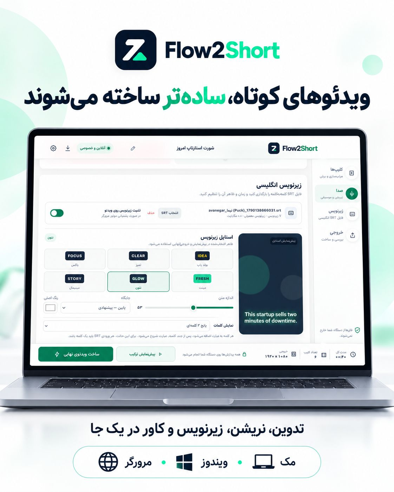
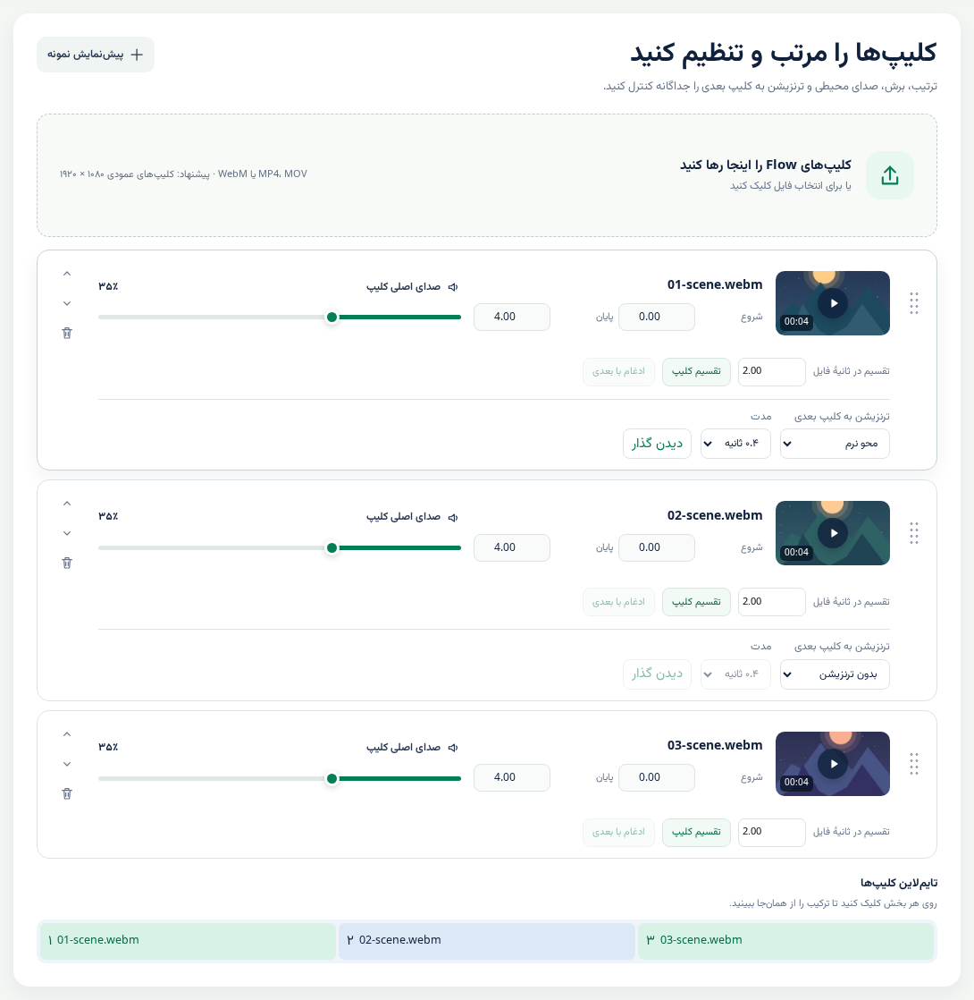
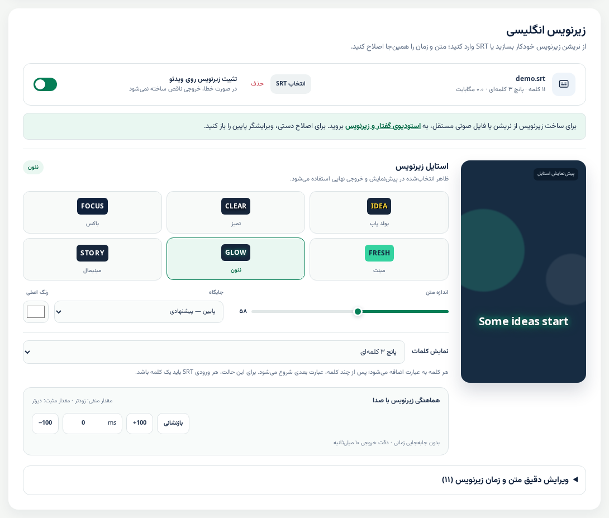
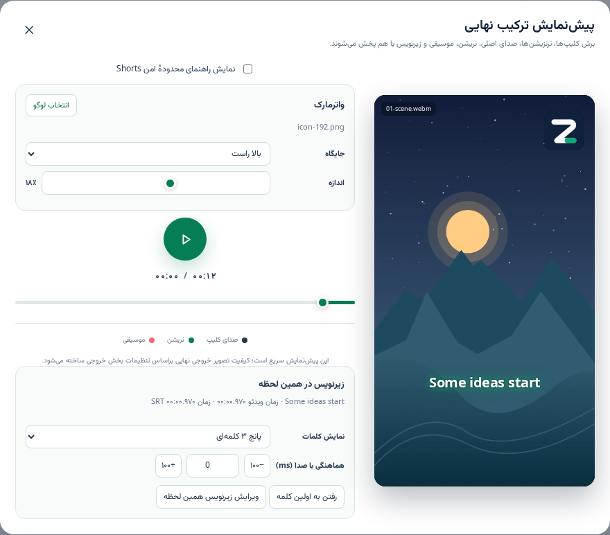
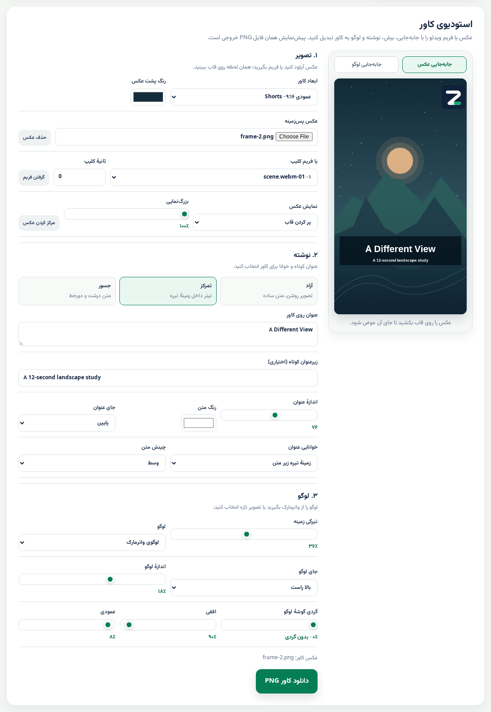
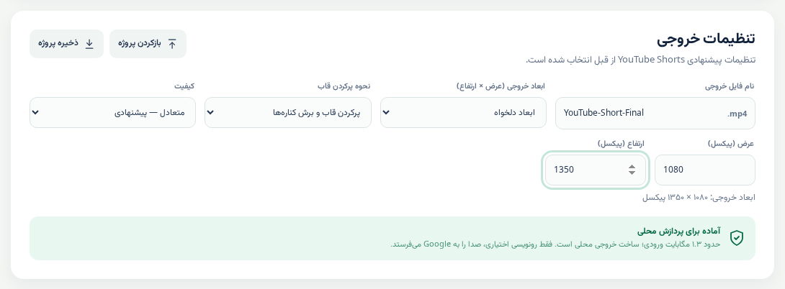

<div dir="rtl">

# Flow2Short Studio

**تدوین، نریشن، زیرنویس و کاور در یک جا.** Flow2Short یک ابزار فارسی برای ساخت ویدئوهای کوتاه است. کلیپ‌های Google Flow، موبایل یا هر منبع دیگری را وارد کنید، برش‌ها را بچینید و ویدئوی آمادهٔ انتشار بگیرید. ساخت MP4 و کاور روی دستگاه شما انجام می‌شود.

**[دانلود آخرین نسخهٔ استودیو (ZIP) — نسخهٔ فعلی ۲.۴.۰](https://github.com/Grandudelife/Flow2Short/archive/refs/heads/main.zip)** · [تغییرات نسخهٔ ۲.۴.۰](https://github.com/Grandudelife/Flow2Short/commit/abd31f83f01c5124e6593ead126514b362585368)

<p align="center"></p>

## دانلود و اجرای آخرین نسخه

تمام لینک‌های این بخش به **آخرین کد شاخهٔ main** اشاره می‌کنند؛ نسخهٔ فعلی برنامه **۲.۴.۰** است و تغییرات جدید قاب خروجی را دارد.

| سیستم | دانلود | روش اجرا پس از بازکردن ZIP |
| --- | --- | --- |
| مک | [دانلود آخرین نسخه برای مک (ZIP)](https://github.com/Grandudelife/Flow2Short/archive/refs/heads/main.zip) | فایل `Start Flow2Short.command` را اجرا کنید. |
| ویندوز | [دانلود آخرین نسخه برای ویندوز (ZIP)](https://github.com/Grandudelife/Flow2Short/archive/refs/heads/main.zip) | فایل `Start Flow2Short Windows.bat` را اجرا کنید. |
| مرورگر / توسعه | [دانلود آخرین نسخهٔ وب و سورس (ZIP)](https://github.com/Grandudelife/Flow2Short/archive/refs/heads/main.zip) | پوشهٔ `app/` را با یک وب‌سرور سرو کنید؛ برای اتصال Google از سرور محلی استفاده کنید. |

بستهٔ ZIP برای هر سه روش مشترک است و هر دو لانچر مک و ویندوز را دارد. این بستهٔ به‌روز با لانچر در **مرورگر** اجرا می‌شود و فایل نصب مستقل `.app` یا `.exe` نیست. بسته‌های مستقل قبلی نسخهٔ ۱.۰.۰ هنوز برای ۲.۴.۰ بازسازی نشده‌اند؛ برای دریافت امکانات جدید از لینک‌های بالا استفاده کنید.

### راه‌اندازی روی مک و ویندوز

۱. بسته را دانلود و از ZIP خارج کنید. برای اجرای این بسته Python 3 را نصب کنید؛ در مک، Ruby نیز برای اجرای امکانات بدون Google قابل استفاده است.

۲. لانچر مخصوص سیستم خود را اجرا کنید. اگر مک اجرای آن را مسدود کرد، روی فایل راست‌کلیک کنید و **Open** را بزنید.

۳. برنامه روی آدرس محلی در مرورگر باز می‌شود؛ پنجرهٔ لانچر را تا پایان کار باز بگذارید. فایل `index.html` را مستقیم باز نکنید؛ مرورگر روی آدرس `file://` اجازهٔ ساخت MP4 را نمی‌دهد.

## از کلیپ خام تا خروجی

تصاویر زیر از اجرای واقعی نسخهٔ ۲.۴.۰ با یک پروژهٔ نمونه گرفته شده‌اند.

### ۱. تدوین و ترنزیشن

فایل‌های MP4، MOV یا WebM را وارد کنید. ترتیب، شروع و پایان هر کلیپ و صدای اصلی آن را تغییر دهید. کلیپ را در زمان دلخواه تقسیم کنید و برای هر برش ترنزیشن جداگانه بگذارید.



### ۲. نریشن، موسیقی و زیرنویس

فایل نریشن و موزیک را اضافه کنید یا با کلید Gemini API، در بخش **صدا** متن انگلیسی را به نریشن WAV تبدیل کنید. گوینده را با شنیدن نمونه انتخاب کنید و لحن و سرعت خوانش را تنظیم کنید. موسیقی می‌تواند هنگام نریشن خودکار آرام شود.

از نریشن یا فایل صوتی مستقل، SRT **کلمه‌به‌کلمه** و **استاندارد** بگیرید، یا SRT آماده وارد کنید. متن و زمان هر ردیف، استایل، اندازه، رنگ و جای زیرنویس را تغییر دهید. برای جلو یا عقب بردن کل زیرنویس از تنظیم میلی‌ثانیه استفاده کنید؛ برای نمایش پانچ ۳ یا ۴ کلمه‌ای، SRT باید زمان مستقل هر واژه را داشته باشد.



### ۳. واترمارک، لایه‌ها و پیش‌نمایش

لوگوی PNG، JPG یا WebP را در یکی از ۹ جایگاه بگذارید و اندازه‌اش را تنظیم کنید. متن و عکس زمان‌دار را در قاب پیش‌نمایش بکشید و گردی گوشهٔ عکس را تنظیم کنید. **پیش‌نمایش ترکیب** برش‌ها، ترنزیشن، لایه‌ها، صدا و زیرنویس را با هم نشان می‌دهد.

<p align="center"></p>

### ۴. طراحی کاور ویدئو

برای کاور از عکس یا فریم کلیپ استفاده کنید. برش و بزرگ‌نمایی عکس، عنوان، زیرعنوان و جای لوگو را روی بوم تنظیم کنید. کاور عمودی، افقی یا مربع را به‌صورت **PNG مستقل** دانلود کنید.



### ۵. انتخاب قاب و ساخت MP4

پیش‌فرض نسخهٔ **۲.۴.۰** عرض و ارتفاع اولین کلیپ در ترتیب پروژه است. از اندازه‌های آمادهٔ عمودی، افقی، مربع یا ۴:۵ انتخاب کنید یا عرض و ارتفاع دلخواه بدهید. پیش‌نمایش با همان قاب هماهنگ می‌شود. اگر نسبت کلیپ‌ها متفاوت است، «نمایش کامل با حاشیه تیره» از برش تصویر جلوگیری می‌کند.



اندازهٔ دلخواه باید عدد زوج بین ۶۴ تا ۴۰۹۶ پیکسل برای هر ضلع باشد. اگر ضلع کلیپ اول فرد باشد، برای سازگاری MP4 به عدد زوج پایین‌تر تبدیل می‌شود؛ حداقل ۲ پیکسل.

## ذخیرهٔ پروژه و حریم خصوصی

- **ذخیره پروژه** یک فایل Recipe می‌سازد که تنظیمات و نام فایل‌ها را نگه می‌دارد. بعد از بازکردن Recipe، فایل‌های رسانه‌ای را دوباره انتخاب کنید.
- تدوین، میکس، رندر MP4 و ساخت کاور محلی‌اند. ساخت نریشن، نمونهٔ گوینده و زیرنویس خودکار به اینترنت، کلید Gemini API و لانچر محلی سازگار نیاز دارند؛ با درخواست شما متن یا صدای انتخابی به Google فرستاده می‌شود. کلید در فایل پروژه ذخیره نمی‌شود.
- می‌توانید بدون اتصال Google، فایل نریشن و SRT خودتان را وارد کنید. پس از اینکه نریشن تولید شد، زمان‌بندی زیرنویس از روی همان صدا انجام می‌شود.

## اجرای توسعه

نسخهٔ استاتیک از پوشهٔ `app/` سرو می‌شود. برای اجرای محلی با پشتیبانی از اتصال Google:

```bash
python3 server/local_server.py 43121 app
```

سپس [آدرس محلی برنامه](http://127.0.0.1:43121/) را باز کنید. نسخهٔ استاتیک را می‌توانید روی هاست دلخواه سرو کنید؛ قابلیت‌های Google به همراه سرور محلی ارائه می‌شوند. موتور ویدئو FFmpeg WebAssembly است؛ در پروژه‌های سنگین، خروجی ۷۲۰p حافظه و زمان کمتری نیاز دارد.

- [کد رابط و موتور ویدئو](app/)
- [کد لانچرهای محلی](server/)
- [مجوزهای وابستگی‌ها](THIRD_PARTY_NOTICES.md): برای کد اختصاصی پروژه هنوز مجوز جداگانه‌ای تعیین نشده است.

</div>
